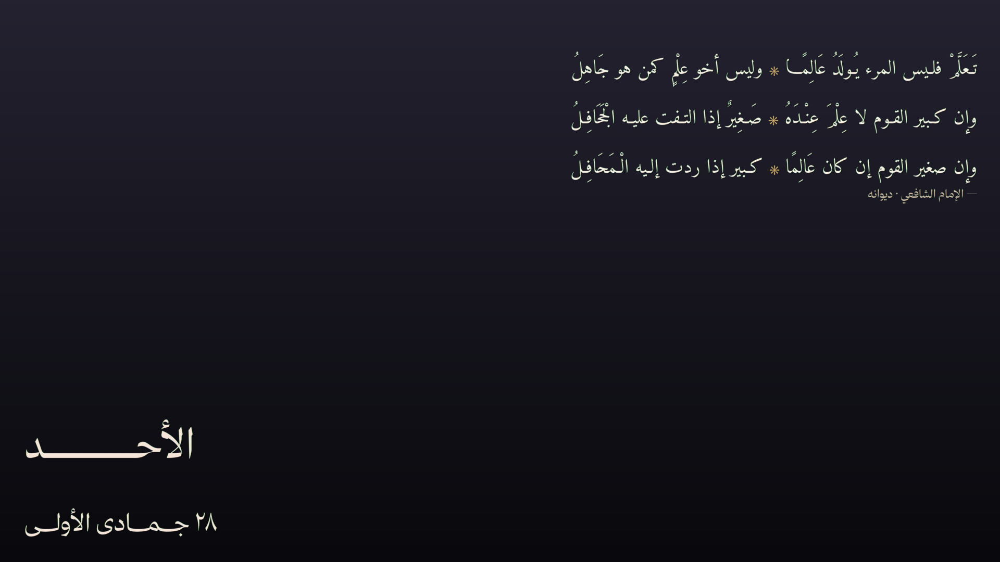

# قصيدة عربية لـ Noctalia

قصائد عربية تتبدّل على سطح مكتب Noctalia، مع يوم الأسبوع بالعربية والتاريخ
الهجري في بطاقتين منفصلتين. هذه نسخة Noctalia v5 من إعداد «Arabic Poem»
القديم على GNOME/azclock، مع الحفاظ على نفس مجموعة القصائد الـ36، والثيمات،
والتشكيل، وأعمدة الشطرين متساوية العرض، وتدوير الخط، والتدوير كل 4
ساعات/عند الاتصال.



## ماذا يفعل

- يعرض قصيدة واحدة في كل مرة من `arabic-poem/data/poems.json` (36 قصيدة).
- يعرض يوم الأسبوع بالعربية والتاريخ الهجري في بطاقتين منفصلتين على سطح المكتب.
- يرسم كل بطاقة كصورة PNG شفافة باستخدام Python وPango وCairo، لذا يكون
  تشكيل الحروف العربية وضبط التطويل وتكافؤ عرض الشطرين دقيقًا.
- لا ينتقل إلى القصيدة التالية إلا بعد 4 ساعات **و** فقط عندما يكون الجهاز
  متصلًا بالإنترنت. وإذا كان غير متصل، تبقى القصيدة الحالية وتحاول الخدمة
  لاحقًا.
- يدوّر خط الأبيات مع القصيدة. الخطّان Amiri Quran وAmiri المضمّنان يمنحان خطّين
  صالحين للاستخدام مباشرة؛ PanoramaNaskh وShafigh وThmanyah اختيارية وتعود
  إلى Amiri عند غيابها.
- يعيد رسم يوم الأسبوع/التاريخ عند منتصف الليل المحلي (يُفحص كل 5 دقائق).
- يوفر زرًا في الشريط وأمر IPC للتدوير اليدوي.
- **لا** يستخدم Rubik للعربية. لا يمسّ Rubik نص القصيدة أو يوم الأسبوع أو
  التاريخ.

لا توجد طبقة eww، ولا مؤقت systemd، ولا اعتماد على GNOME/azclock. تشغّل خدمة
Noctalia الراسم، وتعرض الودجات الثلاث صور PNG التي يكتبها.

## المتطلبات

- Noctalia v5 مع Plugin API 3 أو أحدث.
- أي مدير تركيبات Wayland (niri أو غيره).
- Python 3.10+ مع:
  - PyGObject ووحدات GI لـ Pango/PangoCairo
  - pycairo
- fontconfig
- الخطّان Amiri وAmiri Quran مضمّنان، وتنسخهما الإضافة تلقائيًا إلى مجلد
  خطوط المستخدم عند أول تشغيل. لا تحتاج إلى `install.sh --fonts`.
- `hijridate` **اختياري**: الإضافة تحمل نسخة احتياطية مضمّنة لتقويم أم القرى،
  لذا لا تحتاج إلى `pip install` لتثبيت الإضافة من الواجهة.

تختلف أسماء الحزم بين التوزيعات. حزم شائعة:

```sh
# Arch
sudo pacman -S python python-gobject pango cairo fontconfig

# Fedora
sudo dnf install python3 python3-gobject pango cairo fontconfig

# Debian / Ubuntu
sudo apt install python3 python3-gi python3-cairo gir1.2-pango-1.0 libcairo2 fontconfig
```

إذا كان `python3` في مكان غير معتاد، اضبط إعداد **Python command** في الإضافة
على ذلك المفسّر.

## التثبيت من واجهة Noctalia (الطريقة الأساسية)

لا تحتاج إلى `git clone` ولا إلى `install.sh`. أضف المستودع كمصدر ثم ثبّت
الإضافة من واجهة Noctalia نفسها:

1. افتح **Settings → Plugins → Sources**.
2. اضغط **Add Source**.
3. اكتب اسمًا للمصدر، مثل `arabic-poem`.
4. اختر النوع **Git**.
5. ضع رابط المستودع:

   ```text
   https://github.com/Amr-Os/arabic-poem-noctalia.git
   ```

6. احفظ المصدر.
7. ارجع إلى **Settings → Plugins**، وابحث عن **Arabic Poem**، ثم فعّل
   المفتاح المقابل له.
   - إذا لم تظهر الإضافة مباشرة، اضغط **Update** على المصدر أو أعد فتح
     صفحة الإضافات.
8. أضف الودجات الثلاث من **Settings → Desktop → Widgets**، أو نفّذ:

   ```sh
   noctalia msg desktop-widgets-edit
   ```

اسم المصدر (`arabic-poem`) مجرد تسمية محلية. معرّف الإضافة هو
`amr/arabic-poem`.

عند أول تشغيل للخدمة، ينسخ الراسم الخطّين المضمّنين إلى
`~/.local/share/fonts/Amiri` ويشغّل `fc-cache` تلقائيًا. لا تحتاج إلى خطوة
خطوط منفصلة.

### بديل عبر الطرفية

هذا نفس مسار الواجهة، لكن من الطرفية:

```sh
noctalia msg plugins source add arabic-poem git https://github.com/Amr-Os/arabic-poem-noctalia.git
noctalia msg plugins enable amr/arabic-poem
noctalia msg plugins list
```

`install.sh` بقي كأداة اختيارية للفحص أو المعاينة أو استكشاف الأخطاء فقط:

```sh
./install.sh --check
./install.sh --preview
```

## NixOS

على NixOS، `python3` العادي لا يضع Pango/PangoCairo في `GI_TYPELIB_PATH`،
فتظهر أخطاء مثل:

```text
Namespace Pango not available
Typelib file for namespace 'Pango' not found
```

الحل الجاهز في [`nix/arabic-poem-python.nix`](nix/arabic-poem-python.nix):
غلاف Python يضمّ PyGObject وpycairo، ويضبط `GI_TYPELIB_PATH` لـ Pango
وPangoCairo وcairo وGLib، ويضع `fontconfig` على `PATH` حتى يعمل `fc-cache`
عند نسخ الخطوط تلقائيًا.

مثال مختصر داخل إعداد NixOS:

```nix
{ pkgs, ... }:
let
  poemPython = pkgs.callPackage ./nix/arabic-poem-python.nix { };
in
{
  environment.systemPackages = [ poemPython pkgs.fontconfig ];
  fonts.packages = [ pkgs.amiri ]; # اختياري؛ الإضافة تنسخ Amiri Quran بنفسها
}
```

بعد `nixos-rebuild switch`، اجعل **Python command** في إعدادات الإضافة:

```text
/run/current-system/sw/bin/arabic-poem-python
```

ثم أعد تفعيل الإضافة. لا تضع `python3` المجرّد، لأن وحدة Noctalia في NixOS
تمسح `PATH` الخاص بالخدمة. التفاصيل الكاملة، ومثال Home Manager، وخطوات
التحقق: [`NIXOS.md`](NIXOS.md).

### إضافة الودجات الثلاث

افتح محرر ودجات سطح المكتب:

```sh
noctalia msg desktop-widgets-edit
```

أضف أنواع الودجات الثلاثة:

| الودجة | النوع | اللوحة |
| --- | --- | --- |
| القصيدة | `amr/arabic-poem:poem` | 880 × 380 |
| يوم الأسبوع | `amr/arabic-poem:weekday` | 700 × 140 |
| التاريخ الهجري | `amr/arabic-poem:date` | 700 × 120 |

لكل البطاقات الثلاث:

- أوقف **الخلفية** (Background off) حتى تكون صورة PNG الشفافة هي الطبقة
  المرئية الوحيدة.
- أبقِ مقياس البطاقة عند 1.0 ما لم ترد نصًا أكبر عمدًا.
- لا تدوّر البطاقات.
- الموضع المقترح على شاشة واحدة:
  - القصيدة: أعلى اليمين.
  - يوم الأسبوع: أسفل اليسار، فوق التاريخ.
  - التاريخ: أسفل اليسار، تحت يوم الأسبوع.

تُرسم صور PNG بدقة 2× وتُعرض بحجمها المنطقي، لذا تبقى حادة على شاشات HiDPI.
يطبّق Noctalia مقياس الإخراج فوق ذلك.

### زر الشريط الاختياري

أضف ودجة الشريط **Arabic Poem Refresh** (`amr/arabic-poem:refresh`) من إعدادات
شريط Noctalia. النقر عليها يدوّر القصيدة فورًا ويعرض إشعارًا (ما لم توقف
الإشعارات في إعدادات الإضافة).

### اختصارات niri

أضف الاختصارين إلى `~/.config/niri/config.kdl`:

```kdl
binds {
    Mod+Shift+P { spawn "noctalia" "msg" "plugin" "amr/arabic-poem:service" "all" "force"; }
    Mod+Shift+R { spawn "noctalia" "msg" "plugin" "amr/arabic-poem:service" "all" "refresh"; }
}
```

- `Mod+Shift+P` — يدوّر إلى القصيدة التالية.
- `Mod+Shift+R` — يعيد رسم القصيدة الحالية دون تدوير (تحديث الودجة).

ثم أعد تحميل niri (`niri msg action reload-config` أو طريقتك المعتادة). الأمران
نفسهما يعملان من الطرفية:

```sh
noctalia msg plugin amr/arabic-poem:service all force
noctalia msg plugin amr/arabic-poem:service all refresh
```

## الأوامر

```sh
# دوّر الآن، حتى لو لم تمر 4 ساعات وحتى لو كنت غير متصل.
noctalia msg plugin amr/arabic-poem:service all force

# أعد رسم القصيدة الحالية وبطاقتي التاريخ دون تدوير.
noctalia msg plugin amr/arabic-poem:service all refresh

# اطلب من الخدمة إشعارًا يحتوي مجلد بياناتها،
# والقصيدة الحالية، والخط، وبيانات التاريخ.
noctalia msg plugin amr/arabic-poem:service all status
```

أوامر الراسم المباشرة مفيدة للتنقيح. `--test` لا يكتب شيئًا:

```sh
PLUGIN="$PWD/arabic-poem"
DATA="$HOME/.local/share/arabic-poem"

python3 "$PLUGIN/renderer/update.py" \
  --plugin-dir "$PLUGIN" --data-dir "$DATA" --test --force

python3 "$PLUGIN/renderer/update.py" \
  --plugin-dir "$PLUGIN" --data-dir "$DATA" --status

python3 "$PLUGIN/renderer/update.py" \
  --plugin-dir "$PLUGIN" --data-dir "$DATA" --force

python3 "$PLUGIN/renderer/update.py" \
  --plugin-dir "$PLUGIN" --data-dir "$DATA" --refresh

python3 "$PLUGIN/renderer/update.py" \
  --plugin-dir "$PLUGIN" --data-dir "$DATA" --date-only
```

تستخدم الإضافة مجلد بيانات Noctalia الخاص بها، وليس مسار `$DATA` أعلاه. إشعار
`status` من الخدمة يطبع المسار الحقيقي. إذا شغّلت الراسم يدويًا على مجلد بيانات
الإضافة، فاستخدم ذلك المسار بدلًا منه.

## كيف يعمل

للإضافة خمسة مدخلات:

- `service` — خدمة بلا واجهة تفحص كل 5 دقائق. تشغّل الراسم بـ `--if-due`؛
  ويقرر الراسم هل حان موعد القصيدة وهل تغيّر التاريخ المحلي.
- `poem`، `weekday`، `date` — ثلاث ودجات سطح مكتب. تقرأ
  `render/render.json` وتعرض مسار PNG والعرض والارتفاع المنطقيين عبر
  `ui.image`. لا تعيد الرسم إلا عندما يتغيّر وقت تعديل ملف البيانات الوصفية.
- `refresh` — ودجة شريط اختيارية تشغّل الراسم بـ `--force`.

يخزّن الراسم الحالة في مجلد بيانات Noctalia:

```text
<plugin data dir>/
  config.json        # إعدادات التخطيط/الخط/اللون القابلة للتعديل
  state.json         # القصيدة الحالية، الخط، الطابور، last_change
  render/
    poem-*.png
    weekday-*.png
    date-*.png
    render.json      # البيانات الوصفية التي تستعلم عنها الودجات
  render.log
  render.lock
```

يحتفظ بآخر ثلاث نسخ PNG من كل بطاقة ويكتب `render.json` ذريًا. إذا كان هناك
رسم قيد التنفيذ، يخرج الطلب الثاني بهدوء؛ ويمنع القفل تداخل عمليات التدوير.

منطق التدوير:

1. إذا لم تكن هناك قصيدة حالية، اختر أول قصيدة مفعّلة.
2. إذا مرّت 4 ساعات وكان `is_online()` صحيحًا، اختر القصيدة التالية من
   الطابور المخلوط واختر الخط التالي المتاح.
3. إذا مرّت 4 ساعات لكن الجهاز غير متصل، أبقِ القصيدة الحالية.
4. إذا تغيّر التاريخ الميلادي المحلي، أعد رسم يوم الأسبوع والتاريخ الهجري حتى
   لو لم يحن موعد القصيدة.

`--force` يتجاوز فحص الفاصل والاتصال. `--refresh` يبقي القصيدة والخط الحاليين
ويعيد الرسم. `--date-only` يعيد رسم بطاقتي التاريخ فقط.

## الإعداد

ينسخ الراسم الإعدادات الافتراضية المضمّنة إلى `config.json` في مجلد بيانات
الإضافة عند أول استخدام. عدّل ذلك الملف (إشعار حالة الخدمة يطبع المجلد)، ثم
شغّل:

```sh
noctalia msg plugin amr/arabic-poem:service all refresh
```

أهم المفاتيح:

| المفتاح | الافتراضي | المعنى |
| --- | --- | --- |
| `interval_hours` | `4` | فاصل تدوير القصيدة. |
| `verse_fonts` | `Amiri Quran`، `Amiri`، خطوط اختيارية | خطوط الأبيات المتاحة، بترتيب الأفضلية. تُتجاوز الخطوط غير الموجودة. |
| `font_size_pt` | `31.25` | حجم خط القصيدة. يطابق 25pt القديم في GNOME عند تحجيم النص 1.25. |
| `max_width_px` | `820` | أقصى عرض لنص القصيدة؛ يصغّر الراسم القصائد الطويلة. |
| `tashkeel` | `light` | `light` أو `full` أو `none`. |
| `layout` | `columns` | `columns` لشطرين متساويين في العرض، أو `lines`. |
| `poem_width` / `poem_height` | `880` / `380` | لوحة القصيدة المنطقية. |
| `weekday_width` / `weekday_height` | `700` / `140` | لوحة يوم الأسبوع المنطقية. |
| `date_width` / `date_height` | `700` / `120` | لوحة التاريخ الهجري المنطقية. |
| `weekday_font` / `weekday_size_pt` | Thmanyah Serif Display / `60` | يعود إلى Amiri إذا غاب Thmanyah. |
| `date_font` / `date_size_pt` | Thmanyah Serif Text / `35` | يعود إلى Amiri إذا غاب Thmanyah. |
| `eastern_numerals` | `true` | استخدم `٠١٢٣٤٥٦٧٨٩` في يوم التاريخ الهجري. |
| `shadow_enabled` / `shadow_opacity` / `shadow_blur` | `true` / `0.55` / `3.0` | ظل النص فوق الخلفية. |
| `online_timeout_sec` | `2.0` | مهلة فحص الاتصال. |

إذا كان لديك `config.json` قديم بفاصل 8 ساعات، يرقّيه الراسم تلقائيًا إلى 4
ساعات عند أول تحميل؛ وإذا كان الفاصل مخصصًا (غير 8) فيبقى كما هو.

إعدادات إضافة Noctalia (Settings → Plugins → Arabic Poem) تعرض فقط:

- **Python command** — الافتراضي `python3`.
- **Check interval (minutes)** — الافتراضي `5`، النطاق 1–60.
- **Notify on manual refresh** — مفعّل افتراضيًا.

تخطيط القصيدة/التاريخ موجود في `config.json` لأنه إعداد الراسم، وليس إعدادًا خاصًّا
بالصدفة. تبقى واجهة الإضافة والإشعارات ومخرجات المساعد بالإنجليزية. تظهر العربية
في صور PNG المرسومة؛ وقد تتضمن مخرجات التنقيح الاختيارية `--test`/`--status`
العربية.

## الخطوط

مضمّنة في `arabic-poem/fonts/`:

- Amiri Regular/Bold/Italic/BoldItalic
- Amiri Quran

كلاهما تحت رخصة SIL Open Font License؛ انظر `arabic-poem/fonts/OFL.txt`.
تنسخ الإضافة الخطّين تلقائيًا إلى `~/.local/share/fonts/Amiri` وتشغّل
`fc-cache` عند أول تشغيل. إذا احتجت إلى ذلك يدويًا، استخدم
`./install.sh --fonts`.

الخطوط الاختيارية **غير** مضمّنة:

- PanoramaNaskh
- Shafigh Bakh Thin MOB V2
- Thmanyah Serif Display / Thmanyah Serif Text

إذا كانت مثبتة، يلتقطها الراسم. وإلا يعود إلى Amiri. تتضمن قائمة `verse_fonts`
الافتراضية Amiri، لذا يظل التدوير متاحًا بخطّين حتى مع الملفات المضمّنة فقط.

لا تضف Rubik إلى `verse_fonts` أو إلى مفاتيح خط يوم الأسبوع/التاريخ. مشكلة
Rubik القديمة هي بالضبط ما يتجنبه هذا الراسم.

## استكشاف الأخطاء

**`./install.sh --check` يفشل**

ثبّت حزم التوزيعة الناقصة، ثم أعد التشغيل. يطبع الفحص خطأ استيراد Python
بدقة. `hijridate` لم يعد مطلوبًا لأن الإضافة تحمل نسخة احتياطية مضمّنة.

**`Namespace Pango not available` أو `Typelib file for namespace 'Pango' not found`**

هذا خطأ NixOS شائع. استخدم غلاف
[`nix/arabic-poem-python.nix`](nix/arabic-poem-python.nix) واضبط **Python
command** على `/run/current-system/sw/bin/arabic-poem-python`، ثم أعد تفعيل
الإضافة. اختبره بـ:

```sh
arabic-poem-python -c 'import gi; gi.require_version("Pango", "1.0"); gi.require_version("PangoCairo", "1.0"); from gi.repository import Pango, PangoCairo; print("Pango ok")'
```

انظر [`NIXOS.md`](NIXOS.md) للتفاصيل.

**ودجة القصيدة فارغة**

شغّل الراسم مباشرة بـ `--test` أولًا. إذا نجح، شغّل `--force` وافحص مجلد بيانات
الإضافة. إشعار حالة الخدمة يطبع المسار. انظر `render.log` لآخر رسم.

**العربية تظهر كمربعات أو حروف منفصلة**

افحص الخطوط:

```sh
fc-match 'Amiri Quran'
fc-match 'Amiri'
```

إذا لم تُنسخ الخطوط تلقائيًا، شغّل `./install.sh --fonts` ثم `fc-cache -f`.
يعود الراسم إلى Amiri، ثم Noto Naskh Arabic، ثم DejaVu Sans؛ وإذا لم يوجد أي
منها برموز عربية فسترى مربعات.

**لا يدوّر أبدًا**

الافتراضي 4 ساعات **و** الاتصال بالإنترنت. افحص:

```sh
noctalia msg plugin amr/arabic-poem:service all status
```

`Due now: False` طبيعي حتى تمر 4 ساعات. استخدم `force` للتدوير فورًا. إذا كان
`Due now: True` لكنه لا يتغير، ففحص الاتصال يفشل؛ و`--force` يتجاوزه.

**التاريخ متأخر يومًا**

يستخدم الراسم تقويم أم القرى (عبر `hijridate` إن وُجد، أو النسخة المضمّنة
الاحتياطية). يستخدم التاريخ الميلادي المحلي. تحقق بـ `--test` و`--date-only`؛
وإذا كانت ساعة النظام أو المنطقة الزمنية خاطئة، أصلح ذلك أولًا.

**لا تتحدّث الودجات بعد رسم يدوي**

تستعلم ودجات سطح المكتب عن `render/render.json` مرة كل ثانية. إذا رسمت إلى مسار
`--data-dir` مختلف، فلن تراه. استخدم أمر الخدمة (`force`/`refresh`) ليكتب إلى
مجلد بيانات الإضافة. إعادة تشغيل Noctalia تعيد قراءة الملف أيضًا.

**زر الشريط يقول “Another render is already running”**

هذا قفل الراسم. انتظر لحظة ثم انقر مجددًا؛ الرسم الأول ما زال ينتهي.

## الاختبار

انظر [TESTING.md](TESTING.md) لقائمة اختبار الصديق. تغطي فحص الاعتماديات،
والخطوط، وصور PNG المستقلة، وتفعيل الإضافة، والودجات الثلاث، وتحديث
الشريط/الاختصار، ومخرجات الحالة، والسجلات.

## هيكل المستودع

```text
arabic-poem-noctalia/
  catalog.toml                 # كتالوج مصدر Noctalia
  install.sh                   # مساعد اختياري (check/fonts/preview/source/enable)
  docs/preview.png             # معاينة README
  NIXOS.md                     # تعليمات NixOS وحل مشكلة Pango GI
  nix/
    arabic-poem-python.nix     # غلاف Python يضبط GI_TYPELIB_PATH وfontconfig
  TESTING.md                   # قائمة اختبار الصديق
  arabic-poem/
    plugin.toml                # بيان Noctalia (Plugin API 3)
    entries/                   # الخدمة + 3 ودجات سطح مكتب + زر الشريط
    renderer/                  # راسم Python/Pango
    renderer/hijri_fallback.py # نسخة أم القرى الاحتياطية (دون pip)
    data/poems.json            # مجموعة القصائد الـ36
    data/config.default.json   # الإعدادات الافتراضية للراسم
    fonts/                     # الخطّان Amiri / Amiri Quran المضمّنان (OFL)
    translations/en.json       # تسميات الإعدادات
    README.md                  # README متجر الإضافات
    thumbnail.webp             # صورة مصغرة لمتجر الإضافات
```

## الرخصة

الكود: MIT (انظر `LICENSE`). الخطوط: SIL OFL 1.1 (انظر
`arabic-poem/fonts/OFL.txt`). نصوص القصائد منسوبة إلى شعرائها في
`arabic-poem/data/poems.json` ومضمّنة للعرض الشخصي.
