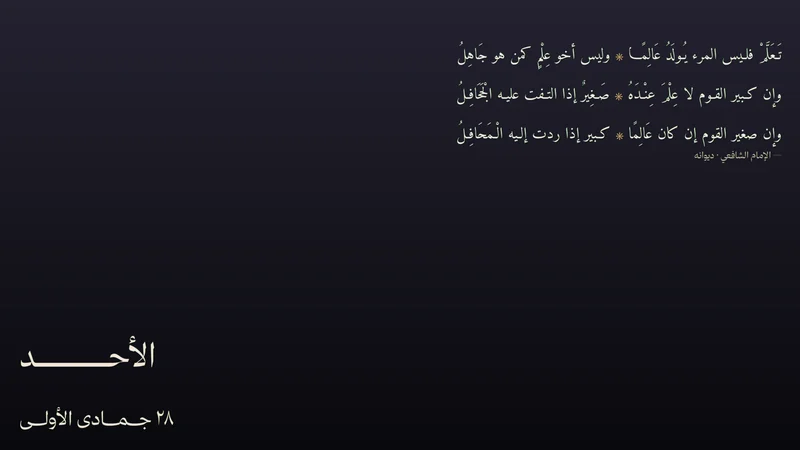

# Arabic Poem

Rotating Arabic poems with the Arabic weekday and Hijri date as three desktop
widgets. This is a Noctalia v5 plugin; it replaces the old GNOME/azclock setup
without putting Arabic text through Rubik or a shell widget.



## Entries

- **Poem** (`amr/arabic-poem:poem`) — the rotating poem tile.
- **Weekday** (`amr/arabic-poem:weekday`) — the Arabic weekday tile.
- **Date** (`amr/arabic-poem:date`) — the Hijri date tile.
- **Refresh** (`amr/arabic-poem:refresh`) — optional bar button that rotates
  immediately.
- **Service** (`amr/arabic-poem:service`) — checks every 5 minutes, rotates
  after 8 hours when online, and redraws the date at local midnight.

## How it renders

Every tile is a transparent PNG rendered by Python, Pango, and Cairo. Arabic
shaping, tashkeel, tatweel justification, equal-width hemistichs, and font
selection all happen in the renderer. The widgets only display the resulting
image with `ui.image`, so they never shape Arabic themselves.

The 36-poem corpus, themes, and tashkeel settings are in
`data/poems.json`. The default fonts are Amiri Quran and Amiri; PanoramaNaskh,
Shafigh, and Thmanyah are optional and fall back to Amiri.

## Install

```sh
noctalia msg plugins source add arabic-poem path /path/to/arabic-poem-noctalia
noctalia msg plugins enable amr/arabic-poem
noctalia msg desktop-widgets-edit
```

Add the three desktop widget types and turn **Background off** on each tile:

- `amr/arabic-poem:poem` — 880 × 380
- `amr/arabic-poem:weekday` — 700 × 140
- `amr/arabic-poem:date` — 700 × 120

Suggested placement on one monitor: poem top-right; weekday bottom-left above
the date; date bottom-left.

Manual rotation:

```sh
noctalia msg plugin amr/arabic-poem:service all force
```

Status:

```sh
noctalia msg plugin amr/arabic-poem:service all status
```

## Requirements

Noctalia v5 with plugin API 3+, Python 3 with PyGObject/Pango/Cairo, the
`hijridate` Python package, fontconfig, and Amiri/Amiri Quran. The repository
root has an `install.sh` helper that checks dependencies, installs the bundled
OFL fonts for your user, renders a preview, and runs the source/enable
commands. It does not use sudo or install distro packages.

See the repository README for distro package names, configuration, and
troubleshooting.

## Settings

- **Python command** — interpreter used for the renderer.
- **Check interval (minutes)** — default 5.
- **Notify on manual refresh** — default on.

Layout, colors, canvas sizes, and fonts live in the renderer's `config.json` in
the plugin data directory. The status notification prints that directory.

## License

MIT for the code; bundled Amiri/Amiri Quran fonts are SIL OFL 1.1. Poem texts
are attributed in `data/poems.json`.
